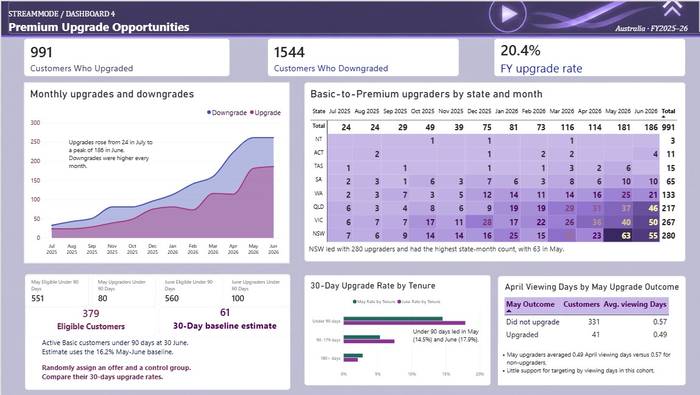

# StreamMODE Premium Upgrade Analysis

**Power BI · DAX · SQL Server**

Generation Australia Data Analytics Program | Team capstone | Australia, FY2025–26

**My contribution:** Gauri Lohar · Dashboard 4: Premium Upgrade Opportunities and SQL data validation

## Dashboard Preview

## Data Source

Generation Australia provided the datasets for our final team capstone. This repository shares aggregate findings, a dashboard screenshot and SQL validation queries. The source datasets are kept separate.

## Business Question

Which Basic subscribers should StreamMODE prioritise for a Premium upgrade offer?

## What I Did

- Used DAX to count distinct customers who upgraded or downgraded during FY2025–26.
- Compared 30-day upgrade rates across three Basic subscriber groups: under 90 days, 90–179 days, and 180 days or more. The comparison windows started on 1 May and 1 June 2026.
- Built Power BI visuals showing monthly upgrades and downgrades, upgrade rates by tenure, and upgrade activity by state.
- Separately validated 14,000 streaming session records in SQL Server for duplicate session IDs, missing values, negative values and playback consistency.
- Identified 213 sessions where playback did not start and retained them in the dataset.

[View the SQL validation queries](./sql/streaming_sessions_validation.sql)

## Key Findings

| Metric | Result |
|---|---:|
| Unique customers who upgraded from Basic to Premium in FY2025–26 | 991 |
| Unique customers who downgraded from Premium to Basic in FY2025–26 | 1,544 |
| 30-day upgrade rate for Basic subscribers with under 90 days of tenure, May window | 14.5% |
| 30-day upgrade rate for Basic subscribers with under 90 days of tenure, June window | 17.9% |

Basic subscribers with under 90 days of tenure had the highest observed 30-day upgrade rate in both windows.

## Recommendation

Run a randomised pilot for active Basic subscribers with under 90 days of tenure. Compare the 30-day upgrade rate of subscribers who receive the offer with that of a control group. Use the difference in upgrade rates and the campaign cost to decide whether to expand the offer.

## Scope and Limitations

Annual upgrade and downgrade counts cover FY2025–26. The tenure comparison uses two historical 30-day windows, beginning on 1 May and 1 June 2026. The proposed pilot would test whether the offer increases upgrades.

## Acknowledgements

Thank you to Dr Bhanu and the entire Generation Australia team for their guidance, encouragement and support throughout the Data Analytics Program. I am grateful to Generation Australia for providing the datasets and to my capstone teammates for their collaboration on the final project.
